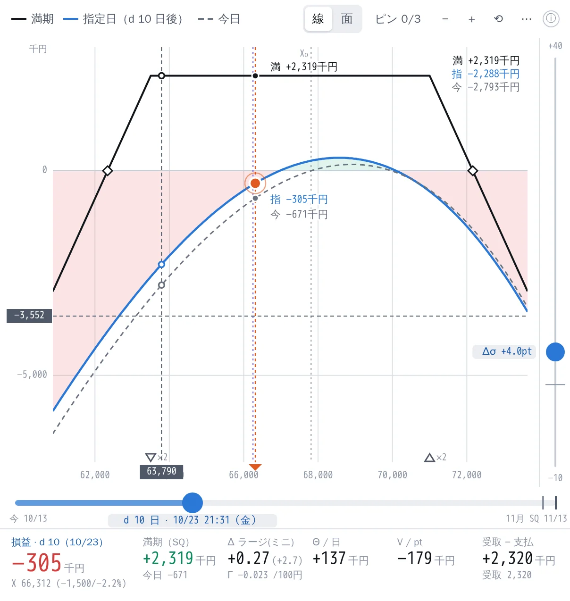
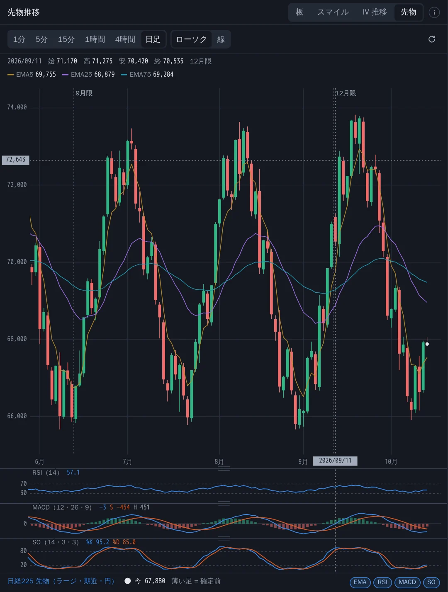
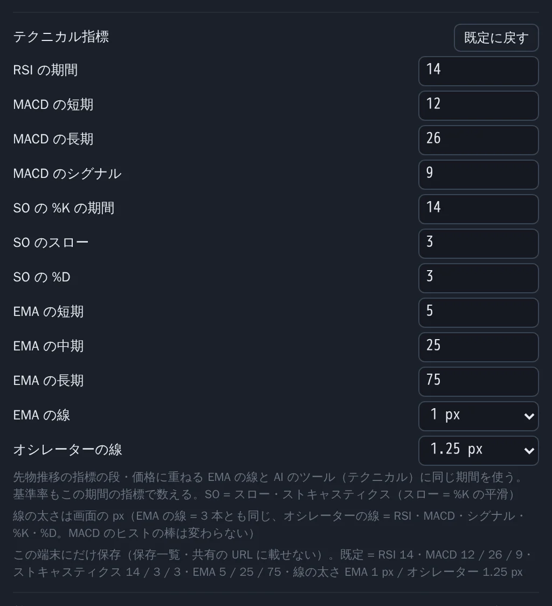
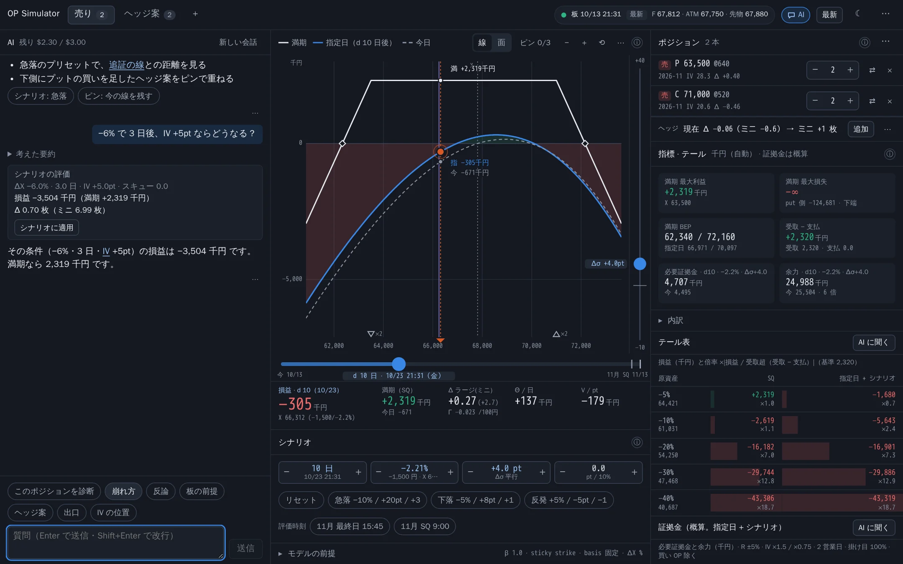
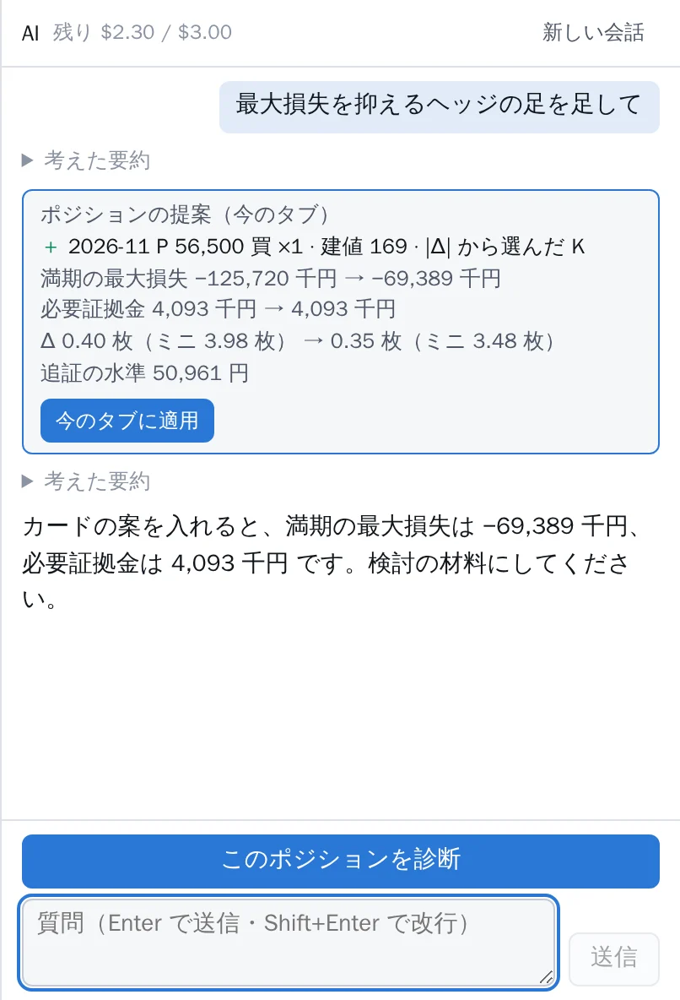
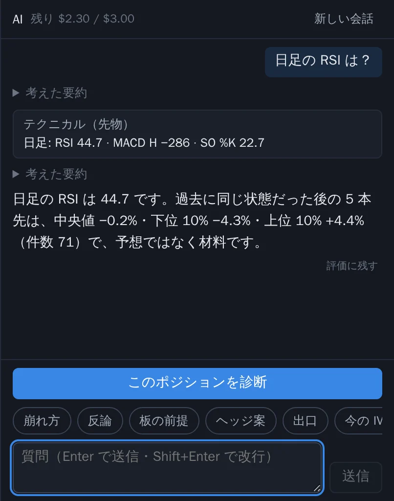
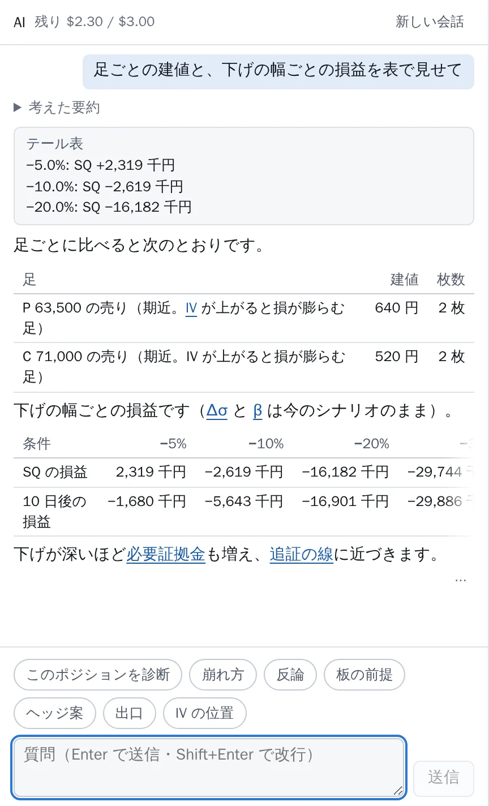

<h1 align="center">OP Simulator</h1>

<p align="center">
  <b>日経225オプションの、建てる前の戦略検討に使う損益シミュレーター。</b><br>
  スマイルを反映した理論損益を、日数・原資産・IV を動かしながらその場で読む。
</p>

<p align="center">
  
</p>

<p align="center">
  <sub>画面はすべて合成の板（Black-76 から作った架空の値）と、手元の開発サーバーの架空の応答で撮影。実在の相場の値ではありません。</sub>
</p>

> [!CAUTION]
> **免責事項（必ずお読みください）**
>
> - このソフトウェアは、オプションの戦略を検討するための **概算のツール** です。**投資助言・売買の推奨ではありません**。AI アドバイザーの提案・見立てを含め、表示はすべて参考情報です
> - 理論価格・グリーク・証拠金・余力はモデルと前提に基づく近似です。板のデータは遅れ・欠け・誤りを含むことがあり、AI の答えは誤りを含むことがあります。表示の正確さ・完全さ・最新さは保証しません
> - **このソフトウェアの利用、または利用できなかったことにより生じたいかなる損失・損害・トラブルについても、作者・貢献者は一切の責任を負いません**（取引の損失、データの誤り、AI の答え、デプロイ・運用にかかった費用、資格情報・利用規約に関わる問題を含みます）
> - 投資判断と、このソフトウェアのデプロイ・運用は、すべてご自身の判断と責任で行ってください
>
> ライセンスは [MIT](LICENSE) です（無保証）。

---

板から足を選んでポジションを組み、満期・指定日・今日の損益を 1 枚のグラフで読みます。グラフのハンドルをつかんで日数・原資産・IV を動かすと、損益・グリーク・証拠金・テールが一緒に動きます。PC では 1 画面に収まり、スマホではドックとシートで切り替えます。

- **損益グラフ** — 満期（解析解）・指定日 + シナリオ・今日の 3 本。十字線で任意の原資産の損益を読む、長押しでシナリオ点をつかむ、ピンで別の案と重ねる（凡例の番号を押すと条件・最大損失）、日数 × 原資産の **面** にも切り替え
- **シナリオ** — 経過日数・原資産 ΔX（−90〜+100%）・IV 平行移動 Δσ・スキュー Δs・β（下落で IV が上がる）。急落 / 下落 / 反発のプリセット
- **指標 · テール** — 最大損益・BEP・合計グリーク（Δ はラージ / ミニ換算）、−5〜−40% のテール表
- **証拠金の概算** — 必要証拠金・余力、損益グラフに **追証の線**、過去の 2 営業日の動きと重ねる **追証マップ**（許容損失を設定すると、その境目も）
- **板とスマイル** — 板の bid で売り・ask で買いの足が入る。スマイル（bid / ask / mid の IV と補間・外挿）の点からも。[効率] で行使価格ごとの **売りの効率**（プレミアム ÷ 必要証拠金）の線
- **IV 推移と先物推移** — ATM IV と日経225 先物のローソク足（1 分〜日足）。先物には EMA の 3 本と RSI・MACD・ストキャスティクスの段
- **AI に相談** — [このポジションを診断]、**定型の質問**（崩れ方・反論・板の前提・ヘッジ案・出口・IV の位置）、続けての質問、画面の数字からの **[AI に聞く]**、ヘッジや組み方の **提案のカード**、先物の **テクニカルの読み**、**IV の過去の統計**（分位・スパイクの戻り方・β の実測・HV）、使い方・計算の前提の質問にはマニュアルの節を示して答える。返答の比較は表で、用語は説明カードへのリンクに。設定に **自分の前提**（資金・許容損失・好む形など）を書くと毎回渡る。数字はこのシミュレーター自身の計算から取る
- **コマンドパレット・用語集・設定** — `Ctrl + K` で何でも、`?` で用語の説明カード。テクニカル指標の期間と線の太さも設定で
- **計算はすべてブラウザ** — サーバーは板などの JSON を返すのと、AI への中継だけ

## 機能ツアー

上から順に、建てる前の検討の流れ（損益を読む → 条件を動かす → リスクと証拠金を見る → 足を選ぶ → 相場の推移を読む → AI に聞く）で並べています。

### 1. 損益グラフ

満期（SQ。折れ点を頂点に持つ解析解）・指定日 + シナリオ・今日の 3 本を重ねます。シナリオ点の縦線と各線の交点に金額のラベル、満期の折れ点と BEP、損益 0 の帯。ホイール / ピンチで拡大、ドラッグでパン。

<table>
  <tr>
    <td width="50%"></td>
    <td width="50%"></td>
  </tr>
  <tr>
    <td><b>十字線</b> — PC はマウスを載せる、スマホはタップで置く。縦線の原資産での満期・指定日・今日の損益と、横線の高さの損益を札で読む（シナリオは変わらない）</td>
    <td><b>長押しでつかむ</b> — シナリオ点を左右に動かすと、交点の金額と下の読み取り（損益・満期・Δ・Θ・V）が付いてくる</td>
  </tr>
  <tr>
    <td></td>
    <td></td>
  </tr>
  <tr>
    <td><b>ピン</b> — 今の線を残す・別のタブ（ヘッジ案）を重ねる。最大 3 本。凡例の ①②③ を押すと、そのピンの条件・満期の最大損失・シナリオ点の損益が出る</td>
    <td><b>面モード</b> — 横 = 原資産、縦 = 経過日数。点をドラッグすると ΔX と d が同時に動く。PC はマウスを載せた点の損益と日数を十字線で読む</td>
  </tr>
</table>

### 2. シナリオ

日数・ΔX・Δσ・Δs をステッパー（± / Shift / スクラブ / ホイール / キー）で。舞台の右の **IV レール** と下の **時間レール** でも同じ値が動きます。急落プリセットは 3 つを同時に入れ、[リセット] はプリセットの行の先頭に。β・sticky strike / moneyness・先物の basis（固定 / 減衰）は「モデルの前提」に。

<p align="center"></p>

### 3. 指標 · テール

<p align="center"></p>

最大利益 / 損失（∞ のときは反対側の有限値）・BEP・受取 − 支払・合計グリーク・必要証拠金・余力のタイルと、−5〜−40% × {SQ, 指定日 + シナリオ} のテール表。タイルの内訳から用語の説明も開けます。

### 4. 証拠金と追証

<table>
  <tr>
    <td width="50%"></td>
    <td width="50%"></td>
  </tr>
  <tr>
    <td><b>追証の線</b> — 資金を設定すると、余力（概算）が 0 になる原資産に赤の破線</td>
    <td><b>追証マップ</b> — 原資産と IV が同時に動いたときの余力（原資産の変化 × IV の倍率）の正負を塗り、過去の 2 営業日の動き（日次の原資産と ATM IV）を点で重ねる。「過去 N 回のうち何回が追証の側か」。設定で許容損失を入れると、シナリオの日数の後の損失が許容損失を超える境目も重なり、3 色で塗り分ける</td>
  </tr>
</table>

証拠金は概算です（掛け目・値動き幅・IV の幅は設定で寄せられます）。資金・許容損失も設定で入れます（この端末にだけ保存）。

### 5. 板とスマイルで足を選ぶ

板の bid を押すと売り、ask を押すと買いの足が入ります。ATM・OTM 度・|Δ| へのジャンプ、限月と put / call の切替。スマイルは OTM 側の bid / ask / mid の IV と、節点・補間・外挿の線（不安定な点は ×）。点を選ぶと、板と同じ規則で足を入れる操作行が出ます。[効率] を押すと、行使価格ごとに 1 枚売ったときの「受け取るプレミアム ÷ 必要証拠金（概算）」の線が重なり、シナリオの IV を動かすと線が動きます。

<p align="center"></p>

### 6. IV 推移と先物推移（テクニカル）

IV 推移は ATM IV（30 日固定）、先物推移は日経225 先物（ラージ・期近）のローソク足 / 線です（1 分・5 分・15 分・1 時間・4 時間・日足）。十字線、左へのパンで過去を読み足し、IV 推移にはシナリオの水準の線。先物は期近をつないだ足（値は調整しない）で、限月が替わった所に縦の点線と限月の札が出ます。IV 推移と先物を切り替えても、足と見ていた期間はそのままです。

先物推移には **EMA の 3 本**（既定 5・25・75）を重ね、[RSI] [MACD] [SO] で価格の下に **テクニカル指標の段** を出せます。段の境目のドラッグで高さを変え、段のダブルクリック / ダブルタップでその段だけを大きく。十字線の縦線は価格と全部の段で同じ足にそろいます。

<p align="center"></p>

<table>
  <tr>
    <td width="50%"></td>
    <td width="50%"></td>
  </tr>
  <tr>
    <td><b>IV 推移</b> — ATM IV のローソク足と、シナリオの IV の水準の線</td>
    <td><b>テクニカル指標の設定</b> — RSI・MACD・SO・EMA の期間と、EMA の線・オシレーターの線の太さ（1〜3 px）。AI のテクニカルの読みも同じ期間・同じ計算</td>
  </tr>
</table>

指標は売買の合図ではありません。

### 7. AI に相談

[このポジションを診断] で、今のポジションの弱点（どこで損が膨らむか・何に弱いか）を AI（Anthropic の Claude）が数字つきで説明します。数字はこのシミュレーターの計算（指標・テール表・証拠金・シナリオの評価と同じ計算）から取り、AI には計算させません。続けて「−6% で 3 日後、IV +5pt なら？」のように質問もできます。指標のタイル・読み取り・テール表・IV 推移の **[AI に聞く]** を押すと、その値が何を表すか・なぜこの値か・今のポジションにとってどうかを、マニュアルの該当の節を示して答えます。

<p align="center"></p>

<table>
  <tr>
    <td width="50%"></td>
    <td width="50%"></td>
  </tr>
  <tr>
    <td><b>ポジションの提案</b> — 「最大損失を抑えるヘッジの足を足して」のように頼むと、足の差分と入れた後の満期の最大損失・必要証拠金・Δ を今 → 後で見せるカード。行使価格は今の板からシミュレーターが選ぶ。提案の先に応じて [今のタブに適用] か [新しいタブに入れる]（ピンで並べて比べられる）。トーストの [元に戻す] で戻せる</td>
    <td><b>テクニカルの読み</b> — 「日足の RSI は？」のように聞くと、先物の週足・日足・4 時間足の RSI・MACD・SO・EMA（先物推移と同じ計算）と、過去に同じ状態だった後の値動きの分布（件数・中央値・上下 10%）を材料として返す。上がる・下がるは断定しない</td>
  </tr>
</table>

<table>
  <tr>
    <td width="50%"></td>
    <td width="50%"><b>表と用語のリンク</b> — AI が表で書いた比較は表で出る（列が多ければ表の中だけを横に動かす）。返答の中の用語（IV・Δσ・β・追証の線 など）は押すと用語の説明カードが開く。計算の値と照合できない数字には点線</td>
  </tr>
</table>

<p align="center"><sub>AI の返答の画像は、手元の開発サーバーの架空の応答で撮った例です（実際の AI は呼んでいません。数字は合成の板からの計算の値）。</sub></p>

- **開き方** — スマホ・タブレットはドックの [AI]、PC はトップバーの [AI] かキー `6`（右の列のポジション・指標と入れ替わる）。コマンドパレットの「AI に相談」「このポジションを診断」からも
- **定型の質問** — [このポジションを診断] の下のチップ（[崩れ方]・[反論]・[板の前提]・[ヘッジ案]・[出口]・[IV の位置]）で、決まった質問を 1 押しで送る。[IV の位置] は材料を並べるだけで、売り時かどうかは言わない
- **IV の過去の統計** — 「今の IV は過去のどの辺？」「跳ねた後どれくらいで萎んだ？」「下げ 2 日で IV はどれだけ跳ねた？」「β の実測は？」「IV は実際の値動き（HV）に比べて高い？」のように聞くと、IV 推移と同じ IV の日々の終値と先物相当の値からシミュレーターが計算した分位・スパイクの戻り方・値動きの大きさ別の IV の変化・β の実測・HV を、件数つきの材料として返す（予想ではない）
- **使い方と計算の前提** — 「追証マップの点は何？」「β と Δσ はどう効くの？」のように聞くと、マニュアルと設計書の該当する節を読んで、節を示して答える（書かれていないことは「書かれていない」と答える）
- **自分の前提** — 設定の「AI に渡す自分の前提」（1,000 字まで）に資金の規模・許せる損失・好む形・避ける形などを書くと、毎回の質問に一緒に渡り、答えの方針に使われる（計算には使わない。この端末にだけ保存）
- **数字の照合** — 返答の中の数字が計算の値と照合できないときは点線の下線が付く（その数字は計算の値ではない）
- **[評価に残す]** — 返答の末尾の ⋯ の中のボタンで、その返答までの会話をファイルにダウンロードできる（サーバーには送らない）。AI の設定を変えたときに同じ条件で解かせ直す材料にする（開発者向け。`api/README.md` の「AI の評価」）
- **[シナリオに適用]** — AI が計算させたシナリオ（日数・ΔX・IV・スキュー）はカードで見せ、1 タップでシナリオに入る。トーストの [元に戻す] で戻せる
- **1 日の上限** — 見出しに今日の残り（例 `残り $2.40 / $3.00`）。使い切ると翌日まで送れない
- **会話は残さない** — このタブの間だけ（再読み込みでは残り、タブを閉じると消える）。保存一覧・URL・書き出しには入らない

管理者が AI を有効にしたときだけ使えます。返答は計算結果をもとにした検討材料で、投資の助言ではありません（売買の判断はご自身で）。

### 8. コマンドパレット・用語集

`Ctrl + K` でパネルの移動・プリセット・評価時刻・ピン・足の追加・テーマ・設定まで。`?` から始めると用語を引けて、ⓘ や指標の内訳の用語からも同じ説明カードが開きます。

<table>
  <tr>
    <td width="50%"></td>
    <td width="50%"></td>
  </tr>
</table>

### 9. スマホ: ドックとシート

舞台（損益グラフ）は常に上に。下のドック（板 / IV / ポジ / シナリオ / 指標 / AI）でパネルを選び、シートを peek / full / 隠すの 3 段階で。幅 360px でも横スクロールしません。

<p align="center"></p>
<p align="center"></p>

使い方の全部は [利用者マニュアル `docs/user-guide.md`](docs/user-guide.md)、画面の設計は [`docs/ui-redesign.md`](docs/ui-redesign.md)。

## しくみとデータ

```
毎分取り込んだ板（BigQuery）
        │  読むだけ（書き込まない）
        ▼
api/（Python 3.13・Flask）  /api/chain・/api/calendar・/api/atm_iv・/api/atm_daily・/api/future_bars
        │  JSON              /api/ai/status・/api/ai/messages（SSE）──中継──▶ Anthropic Claude（AI を有効にしたときだけ）
        ▼
ブラウザ（TypeScript + Preact）  model/ の純関数で Black-76・IV・F・スマイル・満期損益・シナリオ・グリーク・証拠金
                                 AI が求めた計算（シナリオの評価・テール表など）もここで
```

計算はすべてブラウザで行います。サーバーは板などの JSON を返すのと、AI への中継だけです。

- **データ元**: 毎分取り込んだ板を蓄積した BigQuery の最新スナップショット（形と契約は [`docs/design.md`](docs/design.md) 4.1・7 章）、または JSON ファイル（`DATA_SOURCE=file`・画面のファイル選択）。手元では合成の板（`fixtures/synthetic/`）だけで GCP なしに動きます
- **ほかの供給元**: 自分で契約した API から書き出した気配の一覧を読む口（`DATA_SOURCE=quotes`）。形・足し方・候補の比較は [`docs/data-sources.md`](docs/data-sources.md)
- **汎用の作り**: 誰でも clone して自分の環境（自分の GCP プロジェクト・自分の板の BigQuery）で使える作りです。プロジェクト ID・URL・アカウントなどの個人の値はコードに書かず、変数で受け取ります（[`CLAUDE.md`](CLAUDE.md) の「リポジトリに置くもの / 置かないもの」）
- **AI の中継**: ブラウザの会話を `api/` の `/api/ai/messages`（SSE）が許可リストで検査して Claude へ渡します。AI が求めた計算（シナリオの評価など）はブラウザで行い、中継は計算しません。1 日の費用の上限は Firestore で数えます（API キー・WIF のとき）。資格情報は `AI_CREDENTIAL` で 1 つ選びます（Claude のサブスクリプションの OAuth トークンか API キー（どちらも Secret Manager に入れる）、または Anthropic の WIF（鍵なし））。どの資格情報でも、中継は Claude Agent SDK（Claude Code の CLI を中で動かす）を通して送ります（OAuth トークンのときは費用を数えません）。毎回は要らない手順（テクニカル・提案・IV の統計・定型の質問の読み方）はスキルにして AI が要るときだけ読み、マニュアル・設計書の本文は中継が節ごとに返します。未設定なら AI は無効で、ほかの機能はそのまま使えます。
  - **サブスクリプションの OAuth トークンを使う場合は、自分で規約を確かめてください**。Anthropic の文書は、Agent SDK を使って製品・サービスを作る開発者には API キーでの認証を求め、Free / Pro / Max プランの資格情報で利用者の代わりに要求を送ることを認めていません（原文と出典は [`docs/adr-0005-ai-oauth-via-agent-sdk.md`](docs/adr-0005-ai-oauth-via-agent-sdk.md) の「規約」）。使うかどうかはデプロイする人の自己責任です。迷うなら API キーか WIF を使ってください
  - 手順は [`infra/README.md`](infra/README.md) の「AI の資格情報」「AI の費用の計上」と [`api/README.md`](api/README.md)
- **本番の構成**: Cloud Run（IAP の後ろ）+ Terraform（[`infra/README.md`](infra/README.md)）。API は [`api/README.md`](api/README.md)
- **設計**: [`docs/design.md`](docs/design.md)（価格モデル・データ・決定事項）

| ディレクトリ | 中身 |
|---|---|
| `model/` | 価格モデル（Black-76・IV・F の推定・スマイルの補間 / 外挿・時間・満期損益・シナリオ・グリーク）。DOM・通信に依存しない純関数 |
| `data/` | 板の JSON の型と検証、アダプタ、正規化、取引カレンダー |
| `ui/` | 画面（Vite + Preact 10）。表示モデルは `ui/view/` の純関数 |
| `api/` | 板・カレンダー・IV 推移・先物推移を返す API（BigQuery を読むだけ）と AI の中継（`/api/ai/messages`） |
| `infra/` | Terraform（`bootstrap`・`prod`） |
| `fixtures/synthetic/` | 合成の板（架空の値） |
| `tests/` | vitest（文献値・性質テスト・合成板からの回復） |

## はじめる（GCP なし）

```sh
git clone https://github.com/<OWNER>/<REPO>.git && cd <REPO>
npm ci
npm run dev        # http://localhost:5173/ — 合成の板で開く
```

自分の板の BigQuery を読むときは、`api/` を `GCP_PROJECT=<PROJECT_ID>` で起動して `[最新]`（下の「開発」と [`api/README.md`](api/README.md)）。

## 開発

Node 24 を使う（`.node-version`）。

```sh
npm ci
npm run typecheck
npm run lint
npm test
npm run dev        # 画面（ui/）。合成の板 latest.json を既定で読み、night_early / pre_open に切替、[最新] で API（/api を 127.0.0.1:8080 の手元の Flask へプロキシ。api/README.md の DATA_SOURCE=file）、手元の JSON はファイル選択
npm run build      # dist/（合成の板は入らない。本番の画面は開いたら 1 回 /api/chain と /api/calendar を読み、以降は [最新] で読み直す。ファイル選択も使える）
npm run fixtures   # 合成の板 JSON（fixtures/synthetic/）を作り直す。CI は fixtures:check で一致を検査
npm run fixtures -- --wide  # 322 行 × 2 限月の板を fixtures/local/synthetic_wide.json に書く（性能の確認用。コミットしない）
```

画面は docs/ui-redesign.md の設計（#91 で既定に切り替え旧画面を削除。クエリによらず同じ画面）。部品の見本は `npm run dev` の `/?parts`（dev だけ）。画面の検査 `npm run ui:check` は Playwright の Chromium でページの縦・横スクロールと折り返しの件数を測る（CI には入れない。手元で流して PR に出力を貼る。規約は docs/ui-redesign.md 10.1）。

```sh
npx playwright install chromium   # 初回だけ（ブラウザは手元のキャッシュに入る。npm ci では落とさない）
npm run ui:check                  # 画面: 360 / 390 / 900 / 1440 × ダーク / ライト（スマホはシート 3 段階）。縦か横が 0 より大きければ exit 1
npm run ui:check -- --parts --max-wraps 0   # 部品の見本で折り返し 0 件
npm run ui:check -- --flows       # 保存・共有・テーマ・キーボードの手順を pass / fail で出す
npm run ui:check -- --dom <file>  # 要素の tag.class の並びを書き出す（DOM の変化の比較用）
npm run ui:check -- --shots <dir> # スクリーンショット（合成の板だけ。リポジトリに入れない）。--url <base> で起動中の dev サーバーを使う
```

API（`api/`。Python 3.13 + Flask。uv 0.12.19）。手順の詳細・環境変数は [`api/README.md`](api/README.md)。

```sh
cd api
uv sync --locked --python 3.13
uv run --locked ruff check
uv run --locked pytest -q
GCP_PROJECT=<PROJECT_ID> uv run --locked flask --app simulator_api.app run -p 8080   # ADC で BigQuery を読む（読み取りのみ）
DATA_SOURCE=file CHAIN_FILE=../fixtures/synthetic/latest.json uv run --locked flask --app simulator_api.app run -p 8080  # GCP なし
```

`npm run dev` は `/api` を `127.0.0.1:8080`（手元の Flask）へ渡す（Vite の `server.proxy`）。

インフラ（`infra/`。Terraform 1.16.4）。構成・初回の apply・GitHub の設定・デプロイ（`main` への push → plan → Environment `prod` の承認 → apply）は [`infra/README.md`](infra/README.md)。

```sh
TF="mise exec terraform@1.16.4 -- terraform"
$TF fmt -check -recursive infra
for d in bootstrap prod; do   # モックのプロバイダ。資格情報なし
  $TF -chdir=infra/$d init -backend=false -input=false && $TF -chdir=infra/$d validate && $TF -chdir=infra/$d test
done
# イメージ（Cloud Run simulator。API + dist/）のビルドと検査（GCP の認証なし。BigQuery に触れない）
docker build -t simulator:local . && .github/scripts/image-check.sh simulator:local
```

個人の値（CLAUDE.md「置かないもの」）の検査（CI の `check` と同じ。出力はファイル名・行番号・検査名だけ）。変数を渡さなければ形の検査（`run.app` のホスト名・許可リスト外のメール・ホームのパス・10 桁以上のプロジェクト番号・トークンの形）だけ。オーナー名が一般語で誤検出するなら `REPO_OWNER` は空にする。

```sh
.github/scripts/repo-values-check.test.sh   # 検査そのもののテスト
P=$(gcloud config get-value project); REPO=$(gh repo view --json nameWithOwner -q .nameWithOwner)
GCP_PROJECT_ID=$P GCP_PROJECT_NUMBER=$(gcloud projects describe "$P" --format='value(projectNumber)') REPO_OWNER=${REPO%%/*} \
  .github/scripts/repo-values-check.sh
```

## 板のデータ

- `fixtures/synthetic/*.json`: 開発・テストの既定の板。Black-76 から作った **架空の値**（生成器 `scripts/synthBoard.ts`）。形は `docs/design.md` 7.1
- `fixtures/local/`: 実データ（毎分取り込んだ板）の dump を手元で試す置き場。**gitignore 済みで、コミットしない**（実データを公開リポジトリに置かない）。`/api/chain` と同じ形の JSON を置くと `npm test` が検証・正規化を試し（`tests/data/local.test.ts`。件数だけ出す）。`npm run dev` の画面のファイル選択でも読める。Issue / PR には件数・割合などの要約だけを書く。AI のチャットの [評価に残す] で保存した会話は `fixtures/local/ai_eval/cases/` に置く（`npm run ai:eval -- --saved` で送り直す。手順は `api/README.md` の「AI の評価」）。`npm run ai:eval` の各実行は、返答の全文と `summary.json` を `fixtures/local/ai_eval/<時刻>/` に書き、同じモードの前回の実行との差（正答・数値の一致 / 不一致の件数、問ごとの pass ↔ FAIL）を出す

## 取引カレンダー

板の無い限月の SQ 日・取引最終日は、休業日 = 土日 ∪ 取引カレンダーの版（BigQuery のビュー `trading_calendar_latest`）の全行の日付で求める（`docs/design.md` 5.2・7.5）。

- **本番**: 画面は開いたときと [最新] で `/api/calendar`（API が BigQuery から読んだ最新の版）を読む。設定の前提に API の版の日付と確定の最終日（`covered_until`）が出る
- **取れないとき**: 同梱の版（`data/calendar/calendar.json`。`/api/calendar` と同じ形）を使う。dev の合成の板・ファイル選択・`DATA_SOURCE=file` の Flask（`/api/calendar` は 503）でも同梱の版で動く（BigQuery 無しで使える）。前提は「取引カレンダー: 同梱の版（<版の日付>）・確定 … まで」
- **同梱の版の作り直し**（自動更新はしない。期限切れが近いとき・新しい年の休業日が公表されたとき）: BigQuery を読める手元（ADC）で API を起動し、`/api/calendar` だけを呼んで書く（読むのはビュー 1 本・十数 KB。板は読まない）。`npm test` で検証・全月の SQ 日の検査・合成の板の日付との一致を確かめてから PR にする

  ```sh
  cd api && GCP_PROJECT=<PROJECT_ID> uv run --locked flask --app simulator_api.app run -p 8080   # 別の端末で
  curl -sf http://127.0.0.1:8080/api/calendar | python3 -m json.tool --no-ensure-ascii --indent 2 > data/calendar/calendar.json
  npm test
  ```

## スクリーンショットの撮り直し

この README の画像（`docs/images/*.webp`）は `scripts/readmeShots.mjs` で撮っています。Vite の dev サーバーを中で起こし、**合成の板**（`fixtures/synthetic/latest.json`）と dev サーバーの合成の応答（IV 推移・先物推移・日次の値・AI の架空の返答（診断・シナリオの評価・提案・テクニカル・表）。`scripts/devFixtures.mjs`）だけを使います。本番・API・BigQuery・Anthropic には触れません。足・シナリオ・資金・許容損失（架空の値）は localStorage に入れて開きます。

```sh
npx playwright install chromium        # 初回だけ
npm run readme:shots                   # 全部（約 1 分）
npm run readme:shots -- --only hero,phone   # 名前に含む語で一部だけ
```

PNG で撮ってブラウザの canvas で WebP に変えます（依存を足さない）。画面を変えたら撮り直して、1 枚 300 KB・合計 2.2 MB を目安に収めます。

## 免責

このソフトウェアは戦略を検討するための **概算のツール** で、投資助言・売買の推奨ではありません。理論価格・グリーク・証拠金・余力はモデルと前提に基づく近似で、証券会社・取引所の値と一致することを保証しません。板のデータ・AI の答えは誤りを含むことがあり、表示の正確さ・完全さ・最新さは保証しません。

このソフトウェアの利用、または利用できなかったことにより生じたいかなる損失・損害・トラブル（取引の損失、データの誤り、AI の答え、デプロイ・運用の費用、資格情報・利用規約に関わる問題を含む）についても、作者・貢献者は一切の責任を負いません。**投資判断と、デプロイ・運用は、ご自身の判断と責任で行ってください。**

## ライセンス

[MIT License](LICENSE)（著作権表示は [`LICENSE`](LICENSE)）。商用・非商用を問わず、利用・複製・改変・再配布・販売ができます。複製・再配布するときは、ソフトウェアのすべての複製物または重要な部分に、著作権表示と許諾文（[`LICENSE`](LICENSE) の全文）を含めてください。ソフトウェアは無保証（"AS IS"）で提供され、作者・著作権者はいかなる責任も負いません。
