<h1 align="center">OP Simulator</h1>

<p align="center">
  <b>日経225オプションの、建てる前の戦略検討に使う損益シミュレーター。</b><br>
  スマイルを反映した理論損益を、日数・原資産・IV を動かしながらその場で読む。
</p>

<p align="center">
  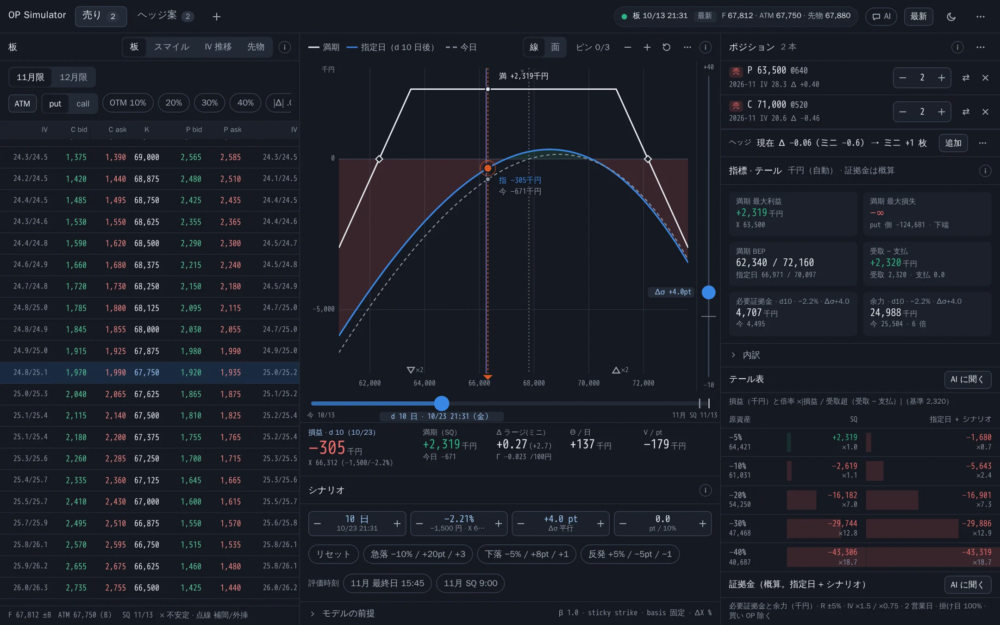
</p>

<p align="center">
  <sub>画面はすべて合成の板（Black-76 から作った架空の値）で撮影。実在の相場の値ではありません。</sub>
</p>

---

グラフのハンドルをつかんで日数・原資産・IV を動かすと、損益・グリーク・証拠金・テールが一緒に動きます。PC では 1 画面に収まり、スマホではドックとシートで切り替えます。

- **損益グラフ** — 満期（解析解）・指定日 + シナリオ・今日の 3 本。長押しでつかんで読む、ピンで別の案と重ねる、日数 × 原資産の **面** にも切り替え
- **シナリオ** — 経過日数・原資産 ΔX（−90〜+100%）・IV 平行移動 Δσ・スキュー Δs・β（下落で IV が上がる）。急落 / 下落 / 反発のプリセット、IV レールと時間レール
- **指標 · テール** — 最大損益・BEP・合計グリーク（Δ はラージ / ミニ換算）、−5〜−40% のテール表
- **証拠金の概算** — 必要証拠金・余力、損益グラフに **追証の線**、過去の 2 営業日の動きと重ねる **追証マップ**
- **市場** — 板（bid で売り・ask で買い）、スマイル（bid / ask / mid の IV と補間・外挿）、ATM IV の推移（ローソク足・十字線）
- **コマンドパレットと用語集** — `Ctrl + K` で何でも、先頭に `?` を付けて引くと用語の説明カード
- **どこでも** — PC の 3 列から、スマホのドックとシートまで。ダーク / ライト
- **計算はすべてブラウザ** — サーバーは板の JSON を返すだけ

## 機能ツアー

### 損益グラフ

満期（SQ。折れ点を頂点に持つ解析解）・指定日 + シナリオ・今日の 3 本を重ねます。シナリオ点の縦線と各線の交点に金額のラベル、満期の折れ点と BEP、損益 0 の帯。ホイール / ピンチで拡大、ドラッグでパン。

<table>
  <tr>
    <td width="50%">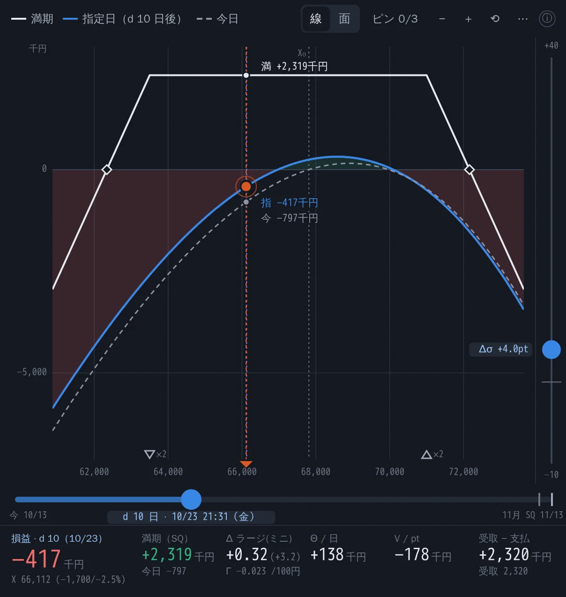</td>
    <td width="50%">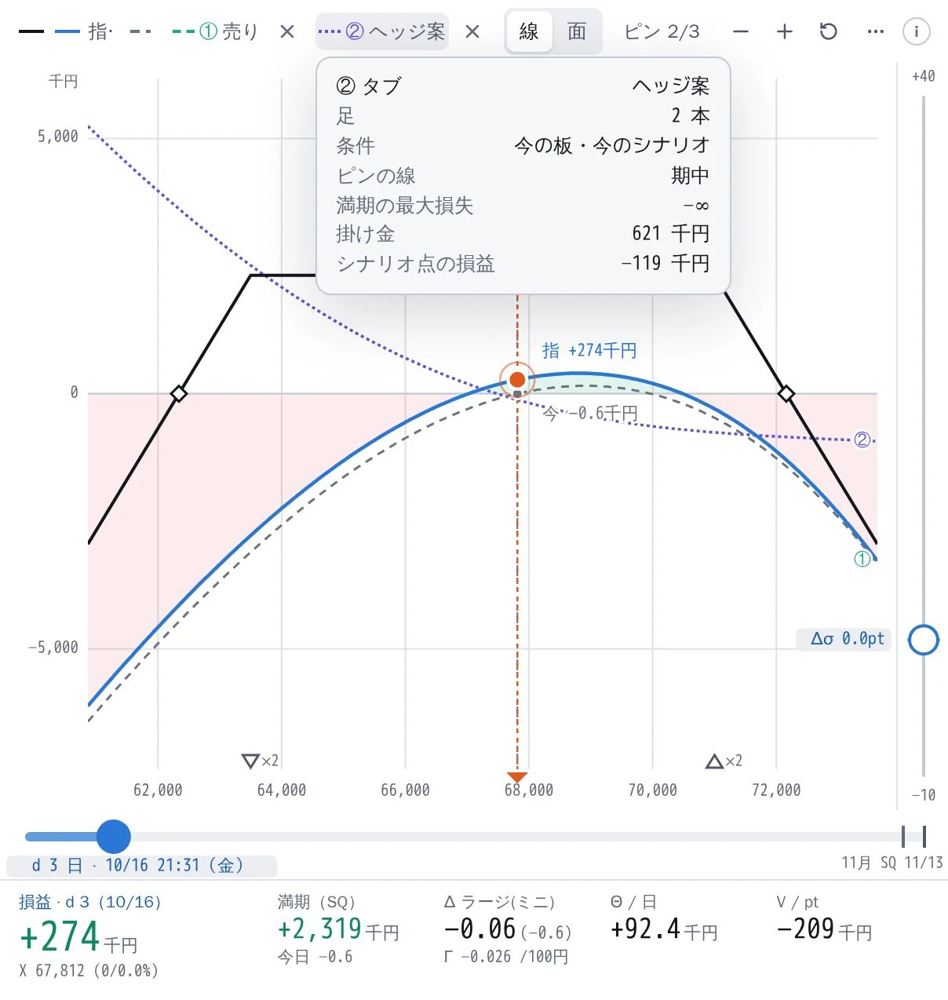</td>
  </tr>
  <tr>
    <td><b>長押しでつかむ</b> — シナリオ点を左右に動かすと、下の読み取り（損益・満期・Δ・Θ・V）が追従</td>
    <td><b>ピン</b> — 今の線を残す・別のタブ（ヘッジ案）を重ねる。最大 3 本</td>
  </tr>
  <tr>
    <td>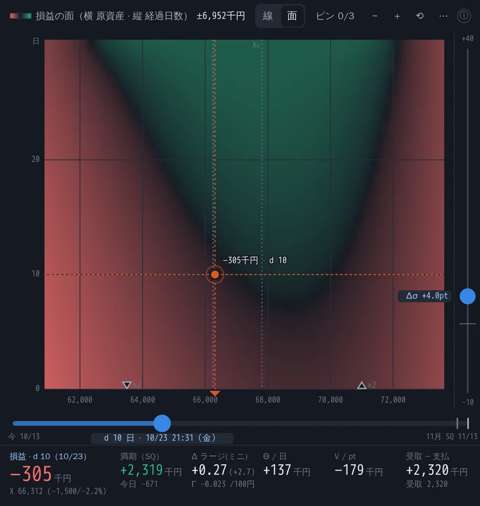</td>
    <td>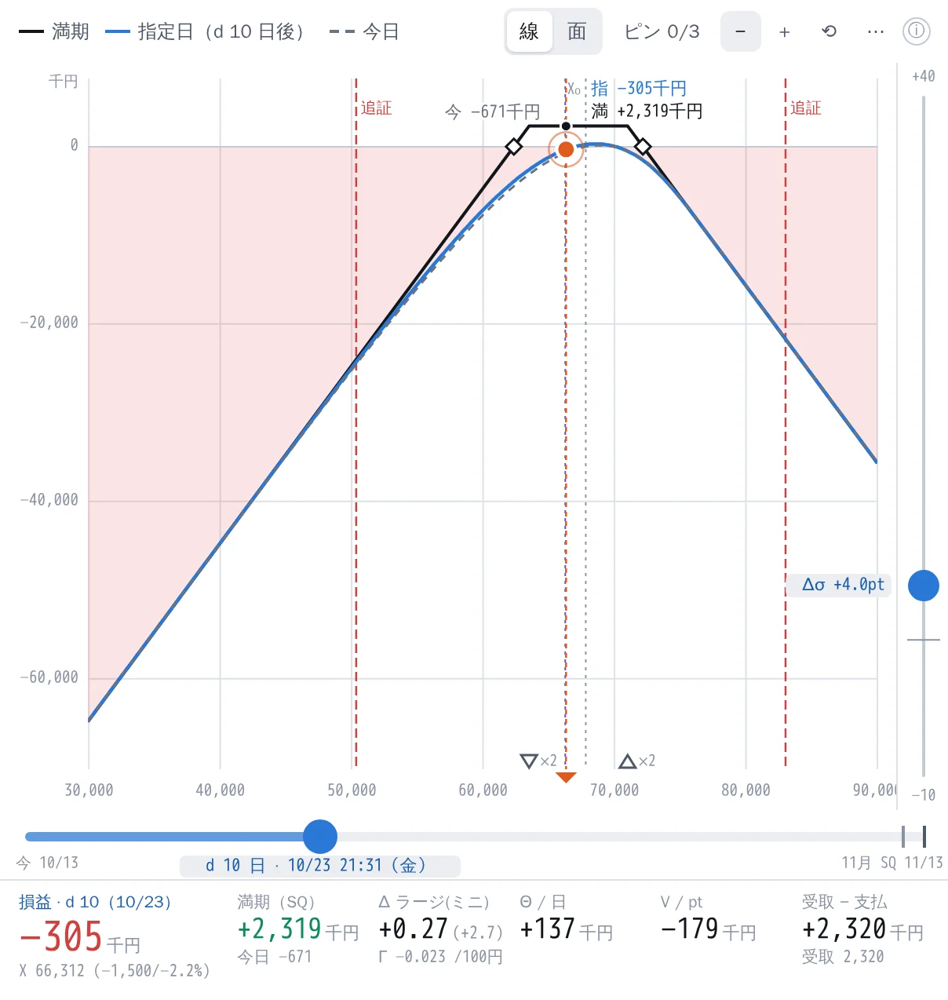</td>
  </tr>
  <tr>
    <td><b>面モード</b> — 横 = 原資産、縦 = 経過日数。点をドラッグすると ΔX と d が同時に動く</td>
    <td><b>追証の線</b> — 資金を設定すると、余力（概算）が 0 になる原資産に赤の破線</td>
  </tr>
</table>

### シナリオ

日数・ΔX・Δσ・Δs をステッパー（± / Shift / スクラブ / ホイール / キー）で。舞台の右の **IV レール** と下の **時間レール** でも同じ値が動きます。急落プリセットは 3 つを同時に入れ、β・sticky strike / moneyness・先物の basis（固定 / 減衰）は「モデルの前提」に。

<p align="center">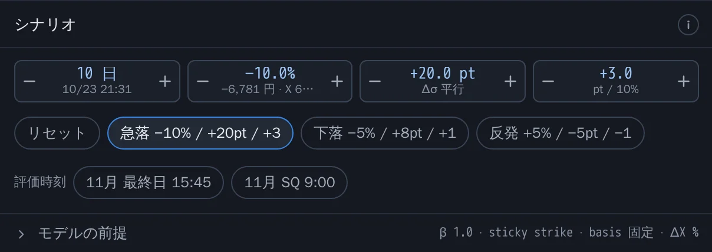</p>

### 指標 · テール と 証拠金の概算

<table>
  <tr>
    <td width="50%">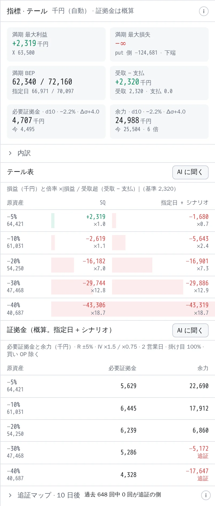</td>
    <td width="50%">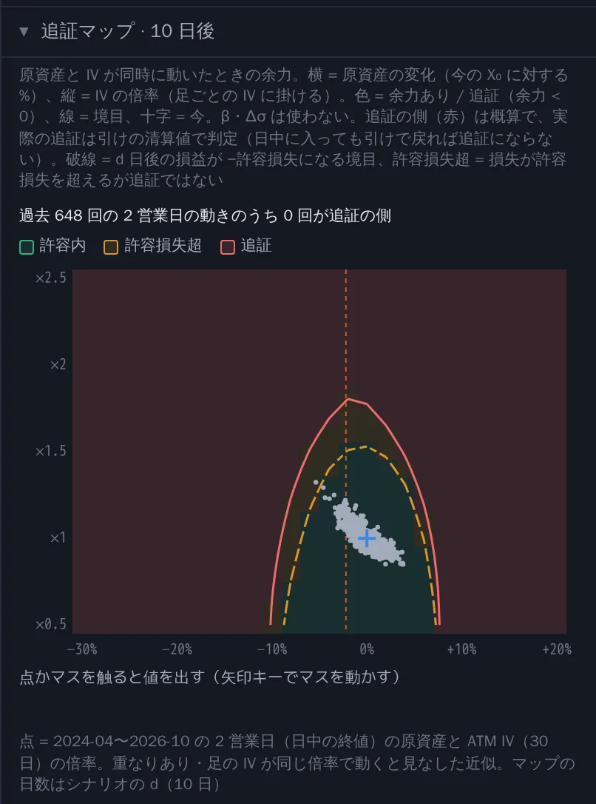</td>
  </tr>
  <tr>
    <td><b>タイル・テール表・証拠金の表</b> — 最大利益 / 損失（∞ のときは反対側の有限値）・BEP・受取 − 支払・合計グリーク・必要証拠金・余力。テールは −5〜−40% × {SQ, 指定日 + シナリオ}</td>
    <td><b>追証マップ</b> — 原資産と IV が同時に動いたときの余力（原資産の変化 × IV の倍率）の正負を塗り、過去の 2 営業日の動き（日次の原資産と ATM IV）を点で重ねる。「過去 N 回のうち何回が追証の側か」</td>
  </tr>
</table>

### 市場: 板・スマイル・IV 推移

板の bid を押すと売り、ask を押すと買いの足が入ります。スマイルは OTM 側の bid / ask / mid の IV と、節点・補間・外挿の線（不安定な点は ×）。点を選ぶと、板と同じ規則で足を入れる操作行が出ます。IV 推移は ATM IV（30 日固定）のローソク足 / 線で、十字線・左へのパンで過去を追加読み込み、シナリオの水準の線。

<table>
  <tr>
    <td width="50%">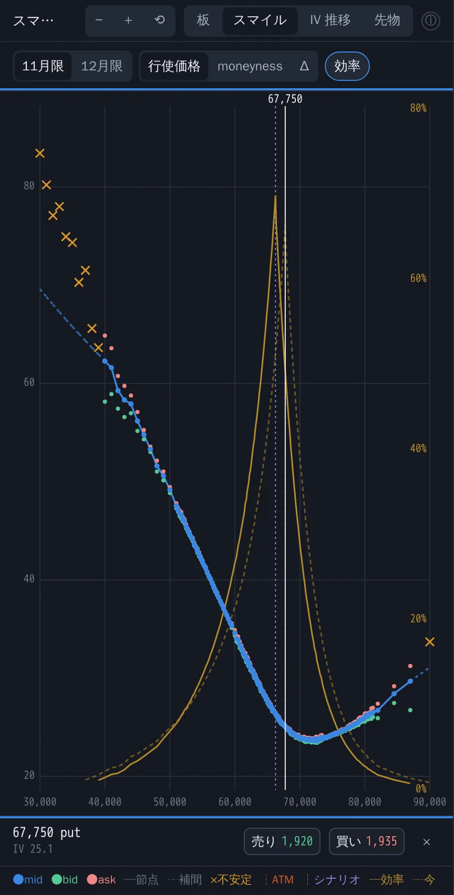</td>
    <td width="50%">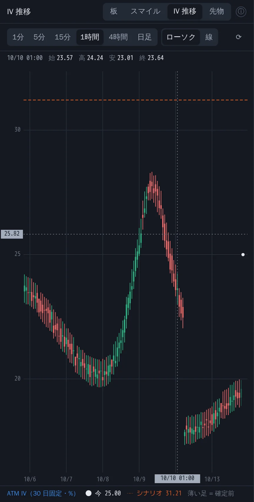</td>
  </tr>
</table>

### コマンドパレットと用語集

`Ctrl + K` でパネルの移動・プリセット・評価時刻・ピン・足の追加・テーマ・設定まで。`?` から始めると用語を引けて、ⓘ や指標の内訳の用語からも同じ説明カードが開きます。

<table>
  <tr>
    <td width="50%">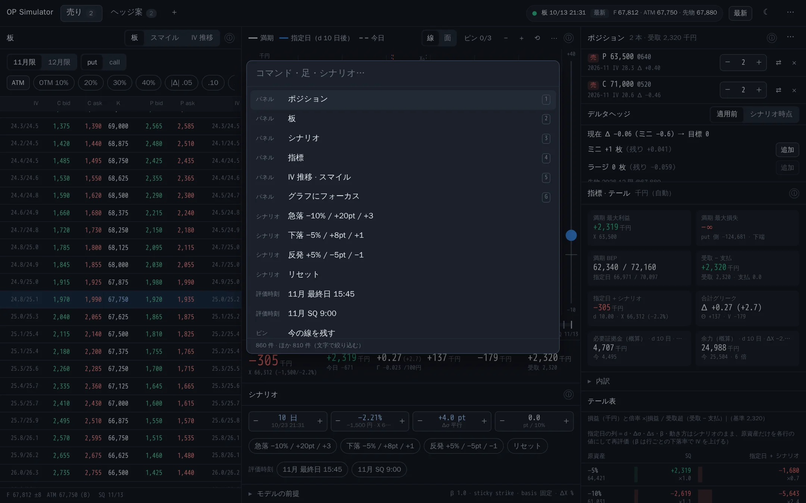</td>
    <td width="50%">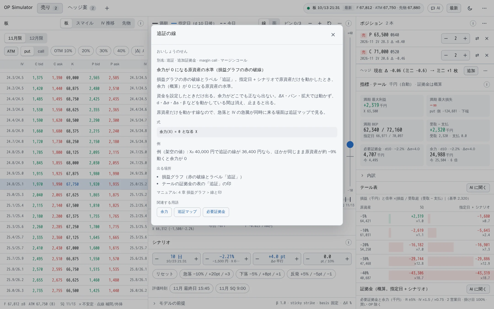</td>
  </tr>
</table>

### スマホ: ドックとシート

舞台（損益グラフ）は常に上に。下のドック（ポジ / 板 / シナリオ / 指標 / IV）でパネルを選び、シートを peek / full / 隠すの 3 段階で。幅 360px でも横スクロールしません。

<p align="center">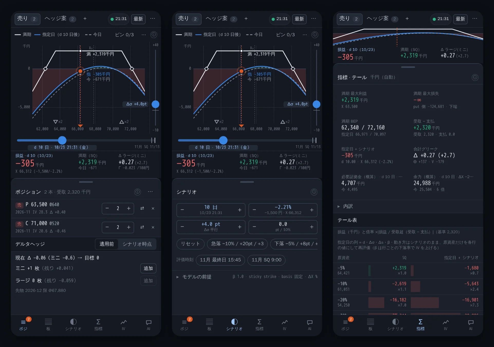</p>
<p align="center">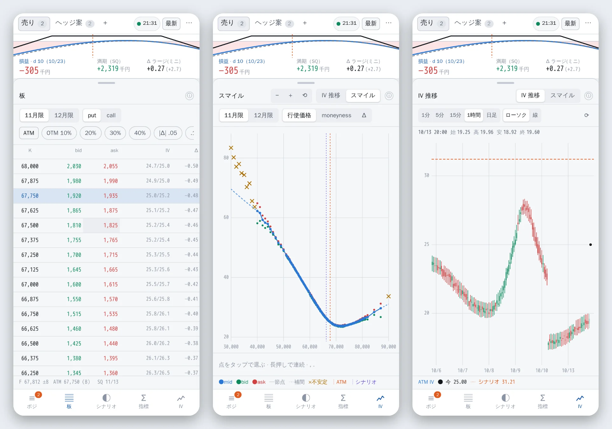</p>

使い方の全部は [利用者マニュアル `docs/user-guide.md`](docs/user-guide.md)、画面の設計は [`docs/ui-redesign.md`](docs/ui-redesign.md)。

## しくみとデータ

```
optionchan（毎分取り込んだ板 → BigQuery）
        │  読むだけ（書き込まない）
        ▼
api/（Python 3.13・Flask）  /api/chain・/api/calendar・/api/atm_iv・/api/atm_daily
        │  JSON
        ▼
ブラウザ（TypeScript + Preact）  model/ の純関数で Black-76・IV・F・スマイル・満期損益・シナリオ・グリーク・証拠金
```

- **データ元**: optionchan（[`docs/design.md`](docs/design.md) 7 章）形式の BigQuery の最新スナップショット、または JSON ファイル（`DATA_SOURCE=file`・画面のファイル選択）。手元では合成の板（`fixtures/synthetic/`）だけで GCP なしに動きます
- **ほかの供給元**: 自分で契約した API から書き出した気配の一覧を読む口（`DATA_SOURCE=quotes`）。形・足し方・候補の比較は [`docs/data-sources.md`](docs/data-sources.md)
- **汎用の作り**: 誰でも clone して自分の環境（自分の GCP プロジェクト・自分の optionchan）で使える作りです。プロジェクト ID・URL・アカウントなどの個人の値はコードに書かず、変数で受け取ります（[`CLAUDE.md`](CLAUDE.md) の「リポジトリに置くもの / 置かないもの」）
- **本番の構成**: Cloud Run（IAP の後ろ）+ Terraform（[`infra/README.md`](infra/README.md)）。API は [`api/README.md`](api/README.md)
- **設計**: [`docs/design.md`](docs/design.md)（価格モデル・データ・決定事項）

| ディレクトリ | 中身 |
|---|---|
| `model/` | 価格モデル（Black-76・IV・F の推定・スマイルの補間 / 外挿・時間・満期損益・シナリオ・グリーク）。DOM・通信に依存しない純関数 |
| `data/` | 板の JSON の型と検証、アダプタ、正規化、取引カレンダー |
| `ui/` | 画面（Vite + Preact 10）。表示モデルは `ui/view/` の純関数 |
| `api/` | 板とカレンダーを返す API（BigQuery を読むだけ） |
| `infra/` | Terraform（`bootstrap`・`prod`） |
| `fixtures/synthetic/` | 合成の板（架空の値） |
| `tests/` | vitest（文献値・性質テスト・合成板からの回復） |

## はじめる（GCP なし）

```sh
git clone https://github.com/<OWNER>/<REPO>.git && cd <REPO>
npm ci
npm run dev        # http://localhost:5173/ — 合成の板で開く
```

自分の optionchan の BigQuery を読むときは、`api/` を `GCP_PROJECT=<PROJECT_ID>` で起動して `[最新]`（下の「開発」と [`api/README.md`](api/README.md)）。

## 開発

Node 24 を使う（`.node-version`）。

```sh
npm ci
npm run typecheck
npm run lint
npm test
npm run dev        # 画面（ui/）。合成の板 latest.json を既定で読み、night_early / pre_open に切替、[最新] で API（/api を 127.0.0.1:8080 の手元の Flask へプロキシ。api/README.md の DATA_SOURCE=file）、手元の JSON はファイル選択
npm run build      # dist/（合成の板は入らない。本番の画面は開いたら 1 回 /api/chain と /api/calendar を読み、以降は [最新] で読み直す。ファイル選択も使える）
npm run fixtures   # 合成の板 JSON（fixtures/synthetic/）を作り直す。CI は fixtures:check で一致を検査
npm run fixtures -- --wide  # 322 行 × 2 限月の板を fixtures/local/synthetic_wide.json に書く（性能の確認用。コミットしない）
```

画面は docs/ui-redesign.md の設計（#91 で既定に切り替え旧画面を削除。クエリによらず同じ画面）。部品の見本は `npm run dev` の `/?parts`（dev だけ）。画面の検査 `npm run ui:check` は Playwright の Chromium でページの縦・横スクロールと折り返しの件数を測る（CI には入れない。手元で流して PR に出力を貼る。規約は docs/ui-redesign.md 10.1）。

```sh
npx playwright install chromium   # 初回だけ（ブラウザは手元のキャッシュに入る。npm ci では落とさない）
npm run ui:check                  # 画面: 360 / 390 / 900 / 1440 × ダーク / ライト（スマホはシート 3 段階）。縦か横が 0 より大きければ exit 1
npm run ui:check -- --parts --max-wraps 0   # 部品の見本で折り返し 0 件
npm run ui:check -- --flows       # 保存・共有・テーマ・キーボードの手順を pass / fail で出す
npm run ui:check -- --dom <file>  # 要素の tag.class の並びを書き出す（DOM の変化の比較用）
npm run ui:check -- --shots <dir> # スクリーンショット（合成の板だけ。リポジトリに入れない）。--url <base> で起動中の dev サーバーを使う
```

API（`api/`。Python 3.13 + Flask。uv 0.12.19）。手順の詳細・環境変数は [`api/README.md`](api/README.md)。

```sh
cd api
uv sync --locked --python 3.13
uv run --locked ruff check
uv run --locked pytest -q
GCP_PROJECT=<PROJECT_ID> uv run --locked flask --app simulator_api.app run -p 8080   # ADC で BigQuery を読む（読み取りのみ）
DATA_SOURCE=file CHAIN_FILE=../fixtures/synthetic/latest.json uv run --locked flask --app simulator_api.app run -p 8080  # GCP なし
```

`npm run dev` は `/api` を `127.0.0.1:8080`（手元の Flask）へ渡す（Vite の `server.proxy`）。

インフラ（`infra/`。Terraform 1.16.4）。構成・初回の apply・GitHub の設定・デプロイ（`main` への push → plan → Environment `prod` の承認 → apply）は [`infra/README.md`](infra/README.md)。

```sh
TF="mise exec terraform@1.16.4 -- terraform"
$TF fmt -check -recursive infra
for d in bootstrap prod; do   # モックのプロバイダ。資格情報なし
  $TF -chdir=infra/$d init -backend=false -input=false && $TF -chdir=infra/$d validate && $TF -chdir=infra/$d test
done
# イメージ（Cloud Run simulator。API + dist/）のビルドと検査（GCP の認証なし。BigQuery に触れない）
docker build -t simulator:local . && .github/scripts/image-check.sh simulator:local
```

個人の値（CLAUDE.md「置かないもの」）の検査（CI の `check` と同じ。出力はファイル名・行番号・検査名だけ）。変数を渡さなければ形の検査（`run.app` のホスト名・許可リスト外のメール・ホームのパス・10 桁以上のプロジェクト番号・トークンの形）だけ。オーナー名が一般語で誤検出するなら `REPO_OWNER` は空にする。

```sh
.github/scripts/repo-values-check.test.sh   # 検査そのもののテスト
P=$(gcloud config get-value project); REPO=$(gh repo view --json nameWithOwner -q .nameWithOwner)
GCP_PROJECT_ID=$P GCP_PROJECT_NUMBER=$(gcloud projects describe "$P" --format='value(projectNumber)') REPO_OWNER=${REPO%%/*} \
  .github/scripts/repo-values-check.sh
```

## 板のデータ

- `fixtures/synthetic/*.json`: 開発・テストの既定の板。Black-76 から作った **架空の値**（生成器 `scripts/synthBoard.ts`）。形は `docs/design.md` 7.1
- `fixtures/local/`: 実データ（optionchan の板）の dump を手元で試す置き場。**gitignore 済みで、コミットしない**（実データを公開リポジトリに置かない）。`/api/chain` と同じ形の JSON を置くと `npm test` が検証・正規化を試し（`tests/data/local.test.ts`。件数だけ出す）。`npm run dev` の画面のファイル選択でも読める。Issue / PR には件数・割合などの要約だけを書く

## 取引カレンダー

板の無い限月の SQ 日・取引最終日は、休業日 = 土日 ∪ 取引カレンダーの版（optionchan の BigQuery のビュー `trading_calendar_latest`）の全行の日付で求める（`docs/design.md` 5.2・7.5）。

- **本番**: 画面は開いたときと [最新] で `/api/calendar`（API が BigQuery から読んだ最新の版）を読む。ヘッダの前提は「取引カレンダー: optionchan の版（<版の日付>）・確定 <covered_until> まで」
- **取れないとき**: 同梱の版（`data/calendar/calendar.json`。`/api/calendar` と同じ形）を使う。dev の合成の板・ファイル選択・`DATA_SOURCE=file` の Flask（`/api/calendar` は 503）でも同梱の版で動く（BigQuery 無しで使える）。前提は「取引カレンダー: 同梱の版（<版の日付>）・…」
- **同梱の版の作り直し**（自動更新はしない。期限切れが近いとき・新しい年の休業日が公表されたとき）: BigQuery を読める手元（ADC）で API を起動し、`/api/calendar` だけを呼んで書く（読むのはビュー 1 本・十数 KB。板は読まない）。`npm test` で検証・全月の SQ 日の検査・合成の板の日付との一致を確かめてから PR にする

  ```sh
  cd api && GCP_PROJECT=<PROJECT_ID> uv run --locked flask --app simulator_api.app run -p 8080   # 別の端末で
  curl -sf http://127.0.0.1:8080/api/calendar | python3 -m json.tool --no-ensure-ascii --indent 2 > data/calendar/calendar.json
  npm test
  ```

## 画面の詳細メモ

<details>
<summary>縦切り 1c・#11・#6・#19・#34 の時点のメモ（現行の画面の正は <code>docs/ui-redesign.md</code>、使い方は <code>docs/user-guide.md</code>）</summary>

- 読み込み: 本番は開いたら 1 回だけ API（`/api/chain`）から板を読み、[最新] で読み直す（自動ポーリングはしない。読み込み中は押せない。足・限月の選択は保つ）。失敗したら種別ごとの文言（503・ログイン切れ・通信エラー・壊れた JSON。応答の本文は出さない）と「前の板のまま（取得 HH:MM）」。localStorage の「古い板」は #23
- ヘッダ: 板の時刻・約 N 分遅れ・最新 / 板寄せ前 / 引け後 / 時間外、取得時刻（ブラウザで読んだ時刻）とデータ元、`latest` 以外は理由の 1 行、日経平均・先物、限月ごとの取引最終日・SQ 日・F（合成先物 / 先物で代用）、ATM の基準 A（ラージ先物）/ B（合成先物。既定）の切替と両方の基準価格。基準価格がスナップショットより 30 分以上古ければ「古い」
- 板: 限月タブ、bid を押すと売り・ask を押すと買いの足が入る。「ATM へ戻る」、OTM 度・|Δ| へのジャンプ、ask ≤ 50 円の絞り込み、印（IV 不安定・補間・外挿・板の IV 欠損・気配なし）。板の枠が狭い（560px 未満。スマホや 2 ペインの中間幅）ときは call / put 切替で K・bid / ask・IV だけ
- 損益グラフ（右ペインの先頭。スマホは板の下）: 横軸 = 基準原資産 X（円）、縦軸 = 損益。線は満期（SQ。折れ点 K − basis_i を頂点に持つ解析解）・指定日 + シナリオ・今日（横軸 1 画素 1 点で再サンプリング）。今日の線はシナリオ IV を掛けない基準の線（d = ΔX = Δσ = Δs = 0。β と sticky の設定は横軸の各点に効く）で、指定日の線は d > 0 または Δσ・Δs ≠ 0 のときだけ描く。印は損益 0 の線、X₀ の縦線、シナリオ点 X₀ + ΔX の縦線、満期の折れ点と BEP。シナリオ点の縦線（ΔX = 0 なら X₀ の縦線）と各線の交点に点と金額のラベル「満 / 指 / 今 + 金額」（金額は指標の単位。範囲外は端に ▲ / ▼）。グラフのすぐ下に読み取りの帯（シナリオ点の X・ΔX・d・損益（指定日・満期・今日）・合計グリーク）があり、シナリオ欄までスクロールしても画面の上端に残る
  - 縦軸: 自動（表示中の範囲の線と 0）/ 手動（下端・上端を円で）/ ±N 倍（受取 − 支払の N 倍。既定 5。プレミアム 0 なら自動）。目盛りは 10 万円以上で千円
  - 横軸の初期範囲は X₀・全足の折れ点・満期の BEP + 余白、縮小の上限は板の全限月の行使価格の位置と初期範囲の和（下端は全足の原資産が 0 以上の点）
- シナリオ（損益グラフの下）: スライダー 4 本 + 数値欄（経過日数 d 0〜最遠の足の SQ・1 日 / 原資産 ΔX −90〜+100%（数値欄は −99〜+900%）・0.5%（円表示は 100 円）/ IV 平行移動 Δσ −10〜+40pt・0.5 / スキュー Δs −5〜+5・0.5）。スライダーにフォーカスして ← → ↑ ↓ で 1 刻み、Shift + 矢印・PageUp / PageDown で 10 刻み、Home / End で端、R でそのスライダーの既定値、+ / − で損益グラフの拡大・縮小。数値欄は範囲外・数でない入力を受け付けない（`−` と先頭の `+` は可）。急落プリセット 3 つ（3 スライダーを同時に設定）、β（既定 1.0pt / 1%、0 で無効）、sticky strike / moneyness、[シナリオをリセット]（β・動き方は保つ）。[basis 固定 / basis 減衰]（先物の足を OP の SQ・指定日に評価するときの basis。減衰は先物の SQ で 0 へ線形。#25）。「SQ 日 9:00」「取引最終日 15:45」は対象の限月（足の限月。既定は SQ が最も近い限月）の時刻に評価時刻を置く d を入れる
- 指標（シナリオの下）: 満期の最大利益・最大損失（解析解。call 側 ∞ のときは put 側の有限値を併記）と BEP、指定日 + シナリオのシナリオ点の理論損益と BEP、合計グリーク（Δ ラージ / ミニ・Γ / 100 円・Θ 円 / 日・V 円 / pt）、足別（`<details>`）、受取 / 支払・手数料・スプレッドコスト・建値ずれ。支払超なら掛け金（支払 − 受取 + 手数料）と利益が掛け金の 1・5・10 倍になる原資産。金額の単位は受取 + 支払が 10 万円未満なら円、以上なら千円（[自動 / 円 / 千円]）。手数料（1 枚あたり円、既定 0）を入れられる
- テール表: 原資産 −5〜−40% の行 × {SQ, 指定日 + シナリオ IV（β 込み）} の損益と倍率 ×|損益 / 基準|（基準は受取超なら受取、支払超なら掛け金）
- 拡大・パン（損益グラフとスマイルで共通。M10）: ホイール = カーソル位置で拡大・縮小（横スクロールはパン）、ドラッグ / 1 本指 = パン、2 本指 = 拡大・縮小、ダブルクリック / ダブルタップ / [⟲] = リセット、[−][＋]。グラフをクリック・Tab でフォーカスしてキー + / − / ← / → / R。損益グラフだけ、**長押し（約 0.5 秒）して左右にドラッグ**でシナリオ点（ΔX。10 円刻み）を動かす。表示中のシナリオ点の縦線はそのままドラッグできる。キー , / . で ΔX ∓100 円、< / > で ∓1,000 円。グラフの中ではページがスクロールしないので、スマホはグラフの外（ツール行・凡例）でスクロールする
- スマイル: OTM 側の bid / ask / mid の IV と σ_smile の線（節点区間は実線、補間・外挿は点線、不安定は ×）、ATM の縦線。横軸は行使価格 / moneyness / デルタ。点（× を含む）をタップ / クリックすると最寄りの行使価格（12px 以内）を選び、下の操作行「K 64,000 put: [売り（bid）] [買い（ask）]」で板と同じ規則の足が入る（ドラッグでは選ばない。限月の切替・板の読み直しで消える）
- ポジション: 足ごとの商品・限月・売買・枚数・建値・IV・Δ（ラージ / ミニ）・Γ・Θ・V・建値ずれ・SQ 日・印。枚数・建値・IV・売買を編集できる。先物の足（既定ミニ）と板の無い限月の OP の足（手入力）を追加できる。保存はまだ無い（再読み込みで消える）
- デルタヘッジ（ポジションの下。#19）: 目標 Δ（ラージ換算、既定 0）に要るミニ・ラージ先物の枚数（符号つき）と追加後の残りを出し、[追加] で先物の足（既定はミニ・板の先物の限月・建値は板の先物価格）が入る。評価点はシナリオ適用前（ポジション一覧の Δ）/ シナリオ時点（指標のシナリオ点）。限月は板の OP の限月も選べる（建値の初期値はその月の合成先物）。ミニが 0 枚ならマイクロ換算を併記。枚数は足・シナリオ・目標の変更ごとに出し直す（再ヘッジ）
- 板の無い限月の足の SQ 日は取引カレンダー（下）で求める。その限月の第 2 金曜が確定の最終日より後なら「休業日未確定」。ヘッダの前提にカレンダーの版（optionchan の版 / 同梱の版）の日付と確定の最終日、評価時刻がカレンダーの `covered_until` を過ぎたら「カレンダー期限切れ」

</details>

<details>
<summary>実装の経緯</summary>

状態: 設計済み。縦切り 1（手元で損益が見える）を実装済み（価格モデル `model/`、データ `data/`、合成の固定の板、画面のヘッダ・板・スマイル・ポジション一覧・損益グラフ（拡大・パン）・シナリオのスライダー・指標・テール表）。縦切り 3 のデルタヘッジ（#19）・先物の basis 固定 / 減衰の切替（#25）を実装済み。縦切り 2 の API（`api/`。板 `/api/chain` とカレンダー `/api/calendar`。#33）を実装済み。インフラは `infra/bootstrap`（WIF・SA・state・Artifact Registry・IAP の閲覧許可。#35）と `infra/prod`（Cloud Run `simulator`（IAP）・イメージ（`Dockerfile`）・PR の plan と承認つきの deploy。#36）を実装済み。画面の既定を API にすること（#34）、閲覧者の追加と本番の受け入れ確認・個人の値の検査（CI）・クエリ量の監視の手順（#40。AC1 の読み込み時間は #95）を済ませた。

</details>

## スクリーンショットの撮り直し

この README の画像（`docs/images/*.webp`）は `scripts/readmeShots.mjs` で撮っています。Vite の dev サーバーを中で起こし、**合成の板**（`fixtures/synthetic/latest.json`）と dev サーバーの合成の応答（IV 推移・日次の値。`scripts/devFixtures.mjs`）だけを使います。本番・API・BigQuery には触れません。足・シナリオ・資金（架空の値）は localStorage に入れて開きます。

```sh
npx playwright install chromium        # 初回だけ
npm run readme:shots                   # 全部（約 1 分）
npm run readme:shots -- --only hero,phone   # 名前に含む語で一部だけ
```

PNG で撮ってブラウザの canvas で WebP に変えます（依存を足さない）。画面を変えたら撮り直して、1 枚 300 KB・合計 3 MB を目安に収めます。

## 免責

このソフトウェアは戦略を検討するための **概算の道具** です。理論価格・証拠金・余力はモデルと前提に基づく近似で、証券会社・取引所の値と一致することを保証しません。表示の正確さ・完全さは保証せず、これを使った取引の結果について作者は責任を負いません。**投資判断はご自身の責任で行ってください。**
